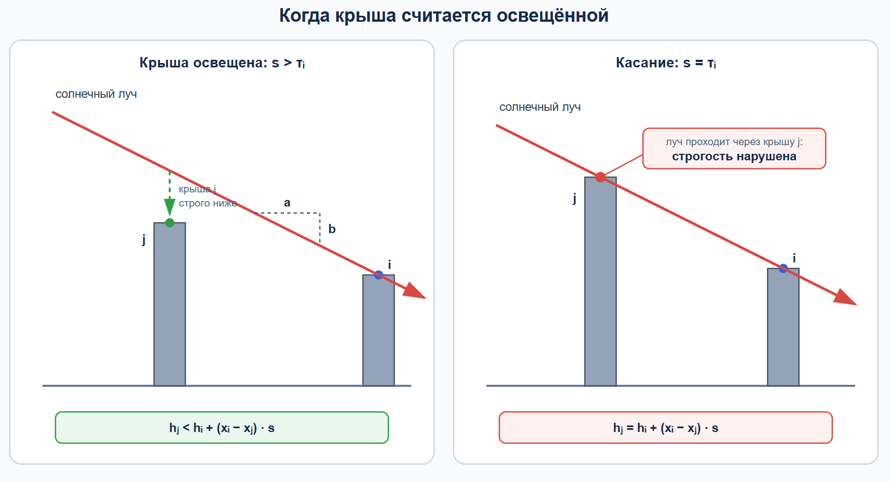
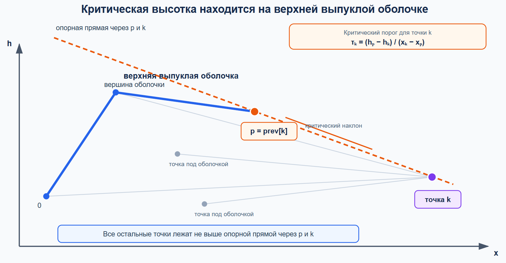
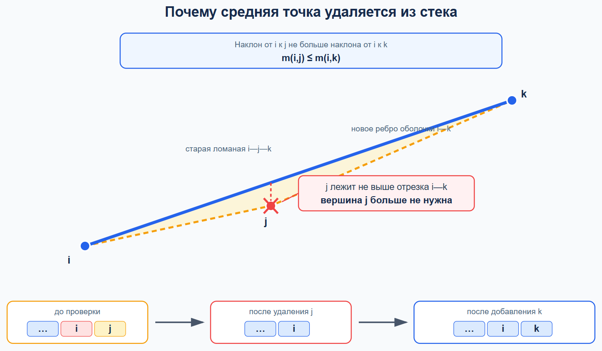
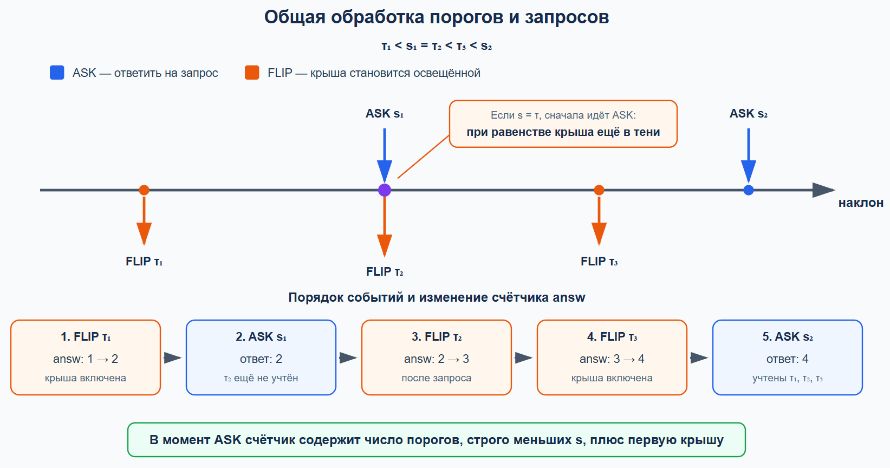

## A. Монеты по кругу

<details><summary><b>Постановка задачи</b></summary>

По кругу расположены $n$ монет, каждая из которых лежит гербом вверх (`H`) или решкой вверх (`T`). Соседними считаются монеты, стоящие рядом в круговом порядке; первая и последняя монеты также соседние.

За один ход разрешается выбрать две соседние монеты и перевернуть обе. Для каждого набора данных требуется найти **минимальное число ходов**, после которых все монеты окажутся в состоянии `H`. Если добиться этого невозможно, нужно вывести $-1$.

Число наборов данных не превосходит $10^4$, длина каждой строки находится в пределах от $3$ до $2\cdot 10^5$, а сумма длин всех строк не превосходит $2\cdot 10^5$.

</details>

<details><summary><b>Основная идея</b></summary>

Порядок ходов не влияет на итоговое состояние. Если одну пару перевернуть дважды, монеты вернутся в прежнее положение, поэтому в оптимальном решении каждое соседство используется не более одного раза.

Выберем любую монету `T`. Чтобы она стала `H`, нужно использовать одно из двух соседних с ней рёбер круга:

- перевернуть её вместе со следующей монетой;
- перевернуть её вместе с предыдущей монетой.

После этого дальнейшие действия **однозначно определяются**. Будем обходить круг по часовой стрелке. Если текущая монета лежит решкой вверх, необходимо перевернуть её вместе со следующей; если она уже лежит гербом вверх, эту пару трогать нельзя.

Проверим оба возможных первых хода и возьмём меньший из полученных ответов. Если оба варианта не приводят к строке из одних `H`, решения нет.

Для строки длины $n$ время работы равно $O(n)$, дополнительная память — $O(n)$ из-за копирования строки.

</details>

<details><summary><b>Детальный разбор</b></summary>

Прямой перебор последовательностей ходов быстро становится неприемлемым: на каждом шаге доступно $n$ соседних пар, а число ходов заранее неизвестно. Чтобы избавиться от порядка действий, сначала заметим важное свойство операции.

Перевороты разных пар можно выполнять в любом порядке: каждая операция лишь меняет состояния двух монет. Более того, два переворота одной и той же пары взаимно уничтожаются. Значит, любую последовательность можно сократить до набора рёбер круга, каждое из которых используется либо один раз, либо не используется вовсе.

Теперь выберем какую-нибудь монету, лежащую решкой вверх, и обозначим её позицию через $i$. На неё влияют только две операции:

- переворот пары $(i-1,i)$;
- переворот пары $(i,i+1)$.

Изначально монета находится в состоянии `T`, поэтому её нужно перевернуть нечётное число раз. Из двух соседних рёбер должно быть выбрано одно. Таким образом, у решения остаются **два возможных варианта начала**: использовать левую или правую пару.

Рассмотрим один из этих вариантов. После первого переворота будем двигаться по кругу в направлении увеличения индексов. Пусть мы дошли до некоторой монеты. Ребро, соединяющее её с предыдущей монетой, уже обработано, поэтому изменить его выбор позднее нельзя. Остаётся решить, использовать ли ребро к следующей монете.

Здесь выбора уже нет:

- если текущая монета имеет состояние `T`, её необходимо перевернуть вместе со следующей;
- если текущая монета имеет состояние `H`, переворачивать пару нельзя, иначе текущая монета станет `T` и исправить её впоследствии не получится.

Следовательно, **выбор первого ребра определяет все последующие действия**. Такой проход последовательно приводит каждую обработанную монету к состоянию `H`.

После полного обхода остаётся проверить замыкание круга. Последний возможный переворот затрагивает исходную границу обхода, поэтому один из вариантов может оказаться противоречивым: все локальные решения были вынужденными, но после возвращения к началу какая-либо монета осталась в состоянии `T`. В этом случае выбранного первого ребра недостаточно для построения допустимого решения.

Почему достаточно проверить только два запуска? В любом допустимом наборе операций выбранная изначально монета `T` переворачивается через одно из двух соседних рёбер. Оба случая рассматриваются отдельно. После фиксации этого ребра остальные решения вынуждены, поэтому проход восстанавливает единственный возможный набор операций для выбранного случая. Значит, ни один допустимый вариант не пропускается.

Если оба прохода успешны, берём меньший счётчик операций. Это и есть минимальный ответ: каждый проход строит единственное решение при заданном первом ребре, а любое решение принадлежит одному из двух рассмотренных случаев. Если оба прохода завершаются неудачей, получить строку из одних `H` невозможно.

Отдельно обрабатывается строка, в которой изначально нет `T`: для неё ответ равен нулю.

Каждый из двух обходов проходит по кругу один раз, поэтому асимптотика по времени равна $O(n)$. В реализациях строка копируется для независимой проверки вариантов, отчего требуется $O(n)$ дополнительной памяти.

</details>

<details><summary><b>Код на C++</b></summary>

```cpp
#include <bits/stdc++.h>
#include <bits/extc++.h>
using namespace std;
const int inf = (int)1e9+7;
void flip(string &s, int i, int j) {
    s[i] = char('T' - s[i] + 'H');
    s[j] = char('T' - s[j] + 'H');
}
int solve(string s, int fi, int se) {
    const int n = (int)s.size();
    flip(s, fi, se);
    int answ = 1;
    for (int i = se; i != fi; (i += 1) %= n)
        if (s[i] == 'T')
            flip(s, i, (i+1)%n), answ++;
    return (s == string(n, 'H') ? answ : inf);
}
void solve() {
    // читаем входные данные
    string s; cin >> s;
    const int n = (int)s.size();
    // находим символ i, который мы должны будем поменять. Либо мы меняем пару (i-1, i).
    // Либо меняем пару (i, i+1). Рассматриваем оба варианта, считаем ответ для каждого, и выводим минимум
    int answ = 0;
    for (int i = 0; i < n; i++)
        if (s[i] == 'T') {
            int fi = solve(s, i, (i+1) % n);
            int se = solve(s, (i-1+n) % n, i);
            answ = min(fi, se);
            break;
        }
    if (answ >= inf) answ = -1;
    cout << answ << '\n';
}
int32_t main() {
    cin.tie(0)->sync_with_stdio(0);
    int tt; cin >> tt;
    while (tt --> 0) solve();
    return 0;
}
```

</details>

<details><summary><b>Код на Python</b></summary>

```python
inf = 10**9+7
def flip(s, i, j):
    s[i] = chr(ord('T')-ord(s[i])+ord('H'))
    s[j] = chr(ord('T')-ord(s[j])+ord('H'))
def solve(s=None, fi=None, se=None):
    if s is not None:
        s = list(s)
        n = len(s)
        flip(s, fi, se)
        answ = 1
        i = se
        while i != fi:
            if s[i] == 'T': flip(s, i, (i+1)%n); answ += 1
            i = (i+1)%n
        return answ if s == ['H']*n else inf
    # читаем входные данные
    s = input()
    n = len(s)
    # находим символ i, который мы должны будем поменять. Либо мы меняем пару (i-1, i).
    # Либо меняем пару (i, i+1). Рассматриваем оба варианта, считаем ответ для каждого, и выводим минимум
    answ = 0
    for i in range(n):
        if s[i] == 'T':
            fi = solve(s, i, (i+1)%n)
            se = solve(s, (i-1+n)%n, i)
            answ = min(fi, se)
            break
    if answ >= inf: answ = -1
    print(answ)
tt = int(input())
for _ in range(tt): solve()
```

</details>

<details><summary><b>Разбор сложных фрагментов кода на C++</b></summary>

```cpp
void flip(string &s, int i, int j) {
    s[i] = char('T' - s[i] + 'H');
    s[j] = char('T' - s[j] + 'H');
}
```

Арифметическое выражение меняет `H` на `T` и `T` на `H`. Если символ равен `H`, получается код символа `T`; если он равен `T`, получается код `H`. Строка передаётся по ссылке, поэтому обе монеты изменяются непосредственно в переданном состоянии.

```cpp
int solve(string s, int fi, int se) {
    const int n = (int)s.size();
    flip(s, fi, se);
    int answ = 1;
```

Строка передаётся **по значению**, так что каждый из двух вариантов проверяется на собственной копии. Пара `(fi, se)` задаёт обязательный первый ход, который сразу учитывается в счётчике.

```cpp
    for (int i = se; i != fi; (i += 1) %= n)
        if (s[i] == 'T')
            flip(s, i, (i+1)%n), answ++;
```

Обход начинается с `se` и продолжается до возвращения в `fi`. Выражение `(i += 1) %= n` циклически увеличивает индекс, переводя $n-1$ в $0$.

К моменту обработки позиции `i` ребро со стороны предыдущей позиции уже определено. Если монета всё ещё лежит решкой вверх, выбирается ребро к следующей позиции. Иначе переход через это ребро пропускается. Запятая в теле `if` позволяет выполнить и переворот, и увеличение счётчика одним выражением.

```cpp
    return (s == string(n, 'H') ? answ : inf);
```

После обхода проверяется не только обработанная часть, но и **согласованность при замыкании круга**. Успешный запуск возвращает число ходов, а неуспешный — большое значение `inf`, которое не сможет стать ответом при наличии допустимого варианта.

```cpp
    int answ = 0;
    for (int i = 0; i < n; i++)
        if (s[i] == 'T') {
            int fi = solve(s, i, (i+1) % n);
            int se = solve(s, (i-1+n) % n, i);
            answ = min(fi, se);
            break;
        }
```

Достаточно найти первую монету `T`. Любое решение использует одно из двух соседних с ней рёбер, поэтому запускаются два вынужденных обхода: с правой парой и с левой парой. Выражение `(i-1+n) % n` корректно получает предыдущий индекс и для позиции $0$.

После обработки первой найденной `T` цикл завершается: разбор другой монеты не добавил бы новых возможных решений. Если символа `T` нет, `answ` остаётся равным нулю.

```cpp
    if (answ >= inf) answ = -1;
```

Если оба запуска вернули `inf`, минимум также не меньше `inf`. Это означает, что ни один возможный первый ход не привёл к допустимому состоянию, поэтому выводится $-1$.

</details>

<details><summary><b>Разбор сложных фрагментов кода на Python</b></summary>

```python
def flip(s, i, j):
    s[i] = chr(ord('T')-ord(s[i])+ord('H'))
    s[j] = chr(ord('T')-ord(s[j])+ord('H'))
```

Функции `ord` и `chr` позволяют поменять `H` на `T`, а `T` на `H` одной формулой. При `s[i] == 'H'` выражение даёт код `T`, а при `s[i] == 'T'` — код `H`.

```python
def solve(s=None, fi=None, se=None):
    if s is not None:
        s = list(s)
        n = len(s)
```

Одна функция выполняет две роли. Без аргументов она обрабатывает набор входных данных, а при переданной строке проверяет конкретный первый ход. Строка преобразуется в список, поскольку отдельные символы строки в Python изменять нельзя. Одновременно создаётся независимая копия состояния для текущего варианта.

```python
        flip(s, fi, se)
        answ = 1
        i = se
        while i != fi:
            if s[i] == 'T': flip(s, i, (i+1)%n); answ += 1
            i = (i+1)%n
```

Сначала выполняется обязательный переворот пары `(fi, se)`. Далее индекс движется по кругу от `se` до `fi`.

Если текущая монета имеет состояние `T`, единственный способ исправить её без изменения уже обработанных позиций — перевернуть её вместе со следующей. Остаток по модулю $n$ обеспечивает переход с последней позиции на нулевую.

```python
        return answ if s == ['H']*n else inf
```

После завершения прохода проверяется вся конфигурация. Это необходимо из-за циклического замыкания: вынужденные решения на промежуточных позициях могут оставить начальную монету в состоянии `T`. Большое значение `inf` обозначает неуспешный вариант.

```python
    answ = 0
    for i in range(n):
        if s[i] == 'T':
            fi = solve(s, i, (i+1)%n)
            se = solve(s, (i-1+n)%n, i)
            answ = min(fi, se)
            break
```

Для первой найденной монеты `T` проверяются оба допустимых соседних ребра. В первом запуске начальной становится пара с последующей монетой, во втором — пара с предыдущей.

После выбора первого ребра остальные операции определяются состояниями монет во время обхода. Поэтому два запуска охватывают все допустимые решения, а продолжать поиск других позиций `T` не требуется. Если решек изначально нет, цикл не меняет `answ`, и ответ остаётся нулевым.

```python
    if answ >= inf: answ = -1
```

Когда оба варианта не проходят итоговую проверку, их минимум равен `inf`. Такое значение заменяется на $-1$, как требуется для невозможного случая.

</details>

## B. Кричалка

<details><summary><b>Постановка задачи</b></summary>

Даны строка $s$ длины $n$ и положительное число $k$.

Требуется найти минимальную положительную длину $t$, для которой строка $s$ является префиксом строки, полученной конкатенацией $k$ копий её собственного префикса длины $t$.

Иными словами, первые $n$ символов строки

$s[0..t)+s[0..t)+\ldots+s[0..t)$

должны совпадать с $s$. Необходимо вывести минимально возможное значение $t$.

</details>

<details><summary><b>Основная идея</b></summary>

Пусть длина повторяющейся части равна $t$. Тогда символы строки, находящиеся на расстоянии $t$ друг от друга, должны совпадать. Это условие можно записать как равенство двух подстрок:

$s[0..n-t)=s[t..n)$.

Кроме того, $k$ копий части длины $t$ должны содержать не меньше $n$ символов, поэтому необходимо выполнение неравенства $t\cdot k\ge n$.

Будем перебирать $t$ по возрастанию. Равенство подстрок проверим за $O(1)$ с помощью двойного полиномиального хеша. Первое значение, удовлетворяющее обоим условиям, и будет ответом.

Предварительное вычисление степеней занимает $O(\text{NMAX})$ времени и памяти. Для каждого теста требуется $O(n)$ времени и $O(n)$ дополнительной памяти.

</details>

<details><summary><b>Детальный разбор</b></summary>

Прямая проверка каждой возможной длины приводит к лишней работе. Для фиксированного $t$ пришлось бы посимвольно строить или сравнивать повторяющуюся строку с исходной, затрачивая $O(n)$. Всего возможны $n$ значений $t$, поэтому такой подход работает за $O(n^2)$.

Сначала разберёмся, **каким свойством обладает подходящая длина**.

Предположим, что повторяющаяся часть имеет длину $t$ и совпадает с префиксом $s[0..t)$. После первых $t$ символов эта часть начинается заново. Следовательно, для каждого индекса $i\ge t$ выполняется равенство

$s[i]=s[i-t]$.

Все эти равенства можно объединить в одно сравнение подстрок:

$s[0..n-t)=s[t..n)$.

Это условие не только необходимо, но и достаточно. Если две указанные подстроки совпадают, то каждый символ $s[i]$ при $i\ge t$ равен символу $s[i-t]$. Повторяя этот переход, получаем символ с индексом меньше $t$. Значит, вся строка образуется последовательным повторением её префикса длины $t$, возможно, с неполной последней копией.

Однако одной периодичности недостаточно. По условию разрешено взять только $k$ копий выбранной части. Их суммарная длина равна $t\cdot k$, поэтому дополнительно требуется

$t\cdot k\ge n$.

Итак, длина $t$ подходит тогда и только тогда, когда одновременно выполнены два условия:

- $s[0..n-t)=s[t..n)$;
- $t\cdot k\ge n$.

Чтобы не сравнивать подстроки посимвольно, будем использовать **полиномиальные хеши**. Для строки заранее вычисляются хеши всех префиксов и степени основания. После этого хеш любой подстроки длины $\text{len}$, начинающейся с позиции $\text{start}$, вычисляется за $O(1)$.

Один модуль оставляет небольшую вероятность случайного совпадения хешей разных строк. В реализации одновременно используются два больших простых модуля и два случайных основания. Пара хешей считается единым значением, поэтому вероятность коллизии пренебрежимо мала.

Теперь переберём $t$ от $1$ до $n$. Для каждого значения сравним хеши подстрок $s[0..n-t)$ и $s[t..n)$. Все найденные периоды сохраняются в порядке возрастания. Затем среди них выбирается первый период, для которого $t\cdot k\ge n$.

**Почему найденный ответ минимален?** Возможные периоды рассматриваются по возрастанию, а ответом становится первый из них, имеющий достаточную суммарную длину после $k$ повторений. Следовательно, меньшего допустимого значения нет.

Ответ всегда существует: при $t=n$ сравниваются две пустые подстроки, а условие $n\cdot k\ge n$ выполняется при положительном $k$.

Для одного теста построение префиксных хешей и перебор периодов требуют $O(n)$ времени. Массив хешей и список периодов занимают $O(n)$ памяти. Степени оснований один раз вычисляются за $O(\text{NMAX})$ времени и занимают $O(\text{NMAX})$ памяти.

</details>

<details><summary><b>Код на C++</b></summary>

```cpp
#include <bits/stdc++.h>
#include <bits/extc++.h>
using namespace std;
// модульная арифметика и хеши:
const int mod1 = (int)1e9+7, mod2 = (int)1e9+9;
int mul(int a, int b, int mod) {
    return int((a * 1LL * b) % mod);
}
struct Hash {
    int x{}, y{};
    Hash(int x_, int y_) : x(x_), y(y_) { }
    Hash(int x_ = 0) : Hash(x_ % mod1, x_ % mod2) { }
    Hash operator+(const Hash &h) const { return Hash((x+h.x)%mod1, (y+h.y)%mod2); }
    Hash operator*(const Hash &h) const { return Hash(mul(x, h.x, mod1), mul(y, h.y, mod2)); }
    Hash operator-(const Hash &h) const { return *this + (-h); }
    Hash operator-() const { return Hash((mod1 - x) % mod1, (mod2 - y) % mod2); }
    friend bool operator==(const Hash &h1, const Hash &h2) { return h1.x == h2.x && h1.y == h2.y; } 
};
int random(int a, int b) {
    static mt19937_64 gen(chrono::high_resolution_clock::now().time_since_epoch().count());
    return uniform_int_distribution<int>(a,b)(gen);
}
const int NMAX = 1 << 20;
const vector<Hash> power = [](){
    vector<Hash> result(NMAX+1, Hash(1));
    int base1 = random(1000, mod1-10) | 1; // нечётное число всегда лучше
    int base2 = random(1000, mod2-10) | 1; // аналогично
    result[1] = Hash(base1, base2);
    for (int i = 2; i <= NMAX; i++)
        result[i] = result[i-1] * result[1];
    return result;
}();
// решение задачи:
void solve() {
    // читаем входные данные:
    int k; string s;
    cin >> k >> s;
    // предварительно вычисляем полиномиальные хеши, чтобы сравнивать подстроки за O(1):
    const int n = (int)s.size();
    vector<Hash> hashes{Hash(0)};
    for (auto it : s)
        hashes.push_back(hashes.back() * power[1] + Hash(it));
    // вычисление хешей на подотрезке [start, start + len):
    auto getHash = [&](int start, int len) {
        return hashes[start+len] - hashes[start] * power[len];
    };
    // находим все возможные периоды: периодичность проверяем хешами, сравнивая подстроки [0, n-t) и [t, n)
    vector<int> answer;
    for (int period = 1; period <= n; period++)
        if (getHash(0, n-period) == getHash(period, n-period))
            answer.push_back(period);
    // ответ: минимальный период, который подходит под ограничения задачи на k дубликатов:
    bool was = false;
    for (auto it : answer)
        if (it * 1LL * k >= n) {
            cout << it << '\n';
            was = 1;
            break;
        }
    assert(was);
}
int32_t main() {
    cin.tie(0)->sync_with_stdio(0);
    int tt; cin >> tt;
    while (tt --> 0) solve();
    return 0;
}
```

</details>

<details><summary><b>Код на Python</b></summary>

```python
from random import randint
# модульная арифметика и хеши:
mod1, mod2 = 10**9+7, 10**9+9
def random(a, b):
    return randint(a, b)
NMAX = 1 << 20
def initPower():
    result = [[1]*(NMAX+1) for _ in range(2)]
    base1 = random(1000, mod1-10) | 1 # нечётное число всегда лучше
    base2 = random(1000, mod2-10) | 1 # аналогично
    result[0][1], result[1][1] = base1, base2
    for i in range(2, NMAX+1):
        result[0][i] = result[0][i-1]*result[0][1]%mod1
        result[1][i] = result[1][i-1]*result[1][1]%mod2
    return result
power = initPower()
# решение задачи:
def solve():
    # читаем входные данные:
    k, s = input().split(); k = int(k)
    # предварительно вычисляем полиномиальные хеши, чтобы сравнивать подстроки за O(1):
    n = len(s)
    hashes = [[0]*(n+1) for _ in range(2)]
    for i, it in enumerate(s):
        hashes[0][i+1] = (hashes[0][i]*power[0][1]+ord(it))%mod1
        hashes[1][i+1] = (hashes[1][i]*power[1][1]+ord(it))%mod2
    # вычисление хешей на подотрезке [start, start + len):
    def getHash(start, len):
        return ((hashes[0][start+len]-hashes[0][start]*power[0][len])%mod1, (hashes[1][start+len]-hashes[1][start]*power[1][len])%mod2)
    # находим все возможные периоды: периодичность проверяем хешами, сравнивая подстроки [0, n-t) и [t, n)
    answer = []
    for period in range(1, n+1):
        if getHash(0, n-period) == getHash(period, n-period): answer.append(period)
    # ответ: минимальный период, который подходит под ограничения задачи на k дубликатов:
    was = False
    for it in answer:
        if it*k >= n:
            print(it)
            was = True
            break
    assert was
tt = int(input())
for _ in range(tt): solve()
```

</details>

<details><summary><b>Разбор сложных фрагментов кода на C++</b></summary>

```cpp
struct Hash {
    int x{}, y{};
    Hash(int x_, int y_) : x(x_), y(y_) { }
    Hash(int x_ = 0) : Hash(x_ % mod1, x_ % mod2) { }
    Hash operator+(const Hash &h) const { return Hash((x+h.x)%mod1, (y+h.y)%mod2); }
    Hash operator*(const Hash &h) const { return Hash(mul(x, h.x, mod1), mul(y, h.y, mod2)); }
    Hash operator-(const Hash &h) const { return *this + (-h); }
    Hash operator-() const { return Hash((mod1 - x) % mod1, (mod2 - y) % mod2); }
    friend bool operator==(const Hash &h1, const Hash &h2) { return h1.x == h2.x && h1.y == h2.y; } 
};
```

Структура `Hash` хранит **два независимых хеша**. Все арифметические операции одновременно выполняются по модулям `mod1` и `mod2`. Унарный минус заменяет каждую компоненту её противоположным значением по модулю, поэтому вычитание реализуется как сложение с отрицательным хешем.

Равенство считается выполненным только при совпадении обеих компонент. Это существенно уменьшает вероятность коллизии.

```cpp
const vector<Hash> power = [](){
    vector<Hash> result(NMAX+1, Hash(1));
    int base1 = random(1000, mod1-10) | 1; // нечётное число всегда лучше
    int base2 = random(1000, mod2-10) | 1; // аналогично
    result[1] = Hash(base1, base2);
    for (int i = 2; i <= NMAX; i++)
        result[i] = result[i-1] * result[1];
    return result;
}();
```

Лямбда вызывается при инициализации глобальной переменной `power` и заранее вычисляет степени двух оснований. Элемент `power[i]` содержит пару значений: степень первого основания по модулю `mod1` и степень второго основания по модулю `mod2`.

Операция `| 1` делает выбранное основание нечётным. Степени вычисляются один раз и затем используются во всех тестах.

```cpp
vector<Hash> hashes{Hash(0)};
for (auto it : s)
    hashes.push_back(hashes.back() * power[1] + Hash(it));
```

`hashes[i]` хранит хеш префикса длины $i$. При добавлении нового символа предыдущий хеш умножается на основание, после чего к нему прибавляется числовое значение символа.

Таким образом, для префикса $s[0..i)$ хранится полиномиальный хеш, в котором порядок символов влияет на результат.

```cpp
auto getHash = [&](int start, int len) {
    return hashes[start+len] - hashes[start] * power[len];
};
```

Из хеша префикса длины `start+len` вычитается вклад первых `start` символов. Умножение на `power[len]` сдвигает этот вклад на нужное число разрядов.

В результате возвращается хеш подстроки на полуинтервале `[start, start + len)`. Все операции выполняются за $O(1)$.

```cpp
for (int period = 1; period <= n; period++)
    if (getHash(0, n-period) == getHash(period, n-period))
        answer.push_back(period);
```

Для предполагаемого периода `period` сравниваются подстроки `[0, n-period)` и `[period, n)`. Их равенство означает, что каждый символ после первых `period` позиций совпадает с символом, стоящим на один период раньше.

При `period == n` длина обеих подстрок равна нулю, поэтому значение `n` всегда попадает в список возможных периодов.

```cpp
for (auto it : answer)
    if (it * 1LL * k >= n) {
        cout << it << '\n';
        was = 1;
        break;
    }
```

Периоды добавлены в `answer` по возрастанию. Проверка `it * 1LL * k >= n` гарантирует, что $k$ копий части длины `it` хватает для получения всех $n$ символов строки.

Множитель `1LL` переводит произведение в тип `long long` и защищает его от переполнения типа `int`. После первого подходящего периода цикл завершается, поэтому выводится минимальный ответ.

</details>

<details><summary><b>Разбор сложных фрагментов кода на Python</b></summary>

```python
def initPower():
    result = [[1]*(NMAX+1) for _ in range(2)]
    base1 = random(1000, mod1-10) | 1 # нечётное число всегда лучше
    base2 = random(1000, mod2-10) | 1 # аналогично
    result[0][1], result[1][1] = base1, base2
    for i in range(2, NMAX+1):
        result[0][i] = result[0][i-1]*result[0][1]%mod1
        result[1][i] = result[1][i-1]*result[1][1]%mod2
    return result
power = initPower()
```

В `result[0]` хранятся степени первого основания по модулю `mod1`, а в `result[1]` — степени второго основания по модулю `mod2`.

Основания выбираются случайно. Операция `| 1` делает каждое из них нечётным. Массив степеней строится один раз до обработки тестов, поэтому повторно вычислять степени для каждой строки не требуется.

```python
hashes = [[0]*(n+1) for _ in range(2)]
for i, it in enumerate(s):
    hashes[0][i+1] = (hashes[0][i]*power[0][1]+ord(it))%mod1
    hashes[1][i+1] = (hashes[1][i]*power[1][1]+ord(it))%mod2
```

Массивы `hashes[0]` и `hashes[1]` содержат хеши всех префиксов строки по двум модулям. Значение `ord(it)` переводит символ в его числовой код.

При переходе к следующему префиксу предыдущий хеш умножается на основание, после чего добавляется очередной символ. Индекс `i+1` соответствует длине построенного префикса.

```python
def getHash(start, len):
    return ((hashes[0][start+len]-hashes[0][start]*power[0][len])%mod1, (hashes[1][start+len]-hashes[1][start]*power[1][len])%mod2)
```

Функция возвращает пару хешей подстроки `[start, start + len)`. Из хеша более длинного префикса вычитается вклад символов, стоящих до `start`.

В Python остаток от деления положителен даже после вычитания, поэтому обе компоненты сразу приводятся к диапазонам соответствующих модулей.

```python
for period in range(1, n+1):
    if getHash(0, n-period) == getHash(period, n-period): answer.append(period)
```

Подстрока `[0, n-period)` сравнивается с подстрокой `[period, n)`. Если их хеши равны, строка повторяет свой префикс длины `period`, а значит, это значение является возможным периодом.

Перебор идёт по возрастанию, поэтому список `answer` также упорядочен.

```python
for it in answer:
    if it*k >= n:
        print(it)
        was = True
        break
```

Неравенство `it*k >= n` проверяет, достаточно ли $k$ копий периода для покрытия всей строки. Первый подходящий элемент списка имеет минимальную длину, поэтому после его вывода перебор прекращается.

</details>

## C. Произведение билетов

<details><summary><b>Постановка задачи</b></summary>

Для каждого набора даны натуральные числа $l$ и $m$, где $1\le l\le 10^{18}$ и $1\le m\le 10^{12}$.

Покупаются все билеты с номерами от $l$ до некоторого $r\ge l$. Требуется найти **минимальное** значение $r$, при котором произведение номеров купленных билетов $\prod_{x=l}^{r}x$ делится на $m$.

Всего дано не более $100$ независимых наборов.

</details>

<details><summary><b>Основная идея</b></summary>

Само произведение быстро становится огромным, а последовательная проверка всех правых границ может потребовать слишком много времени. Вместо произведения будем отслеживать, **сколько раз каждый простой делитель числа $m$ входит в него**.

Разложим $m$ на простые множители: $m=p_1^{k_1}p_2^{k_2}\ldots p_q^{k_q}$. Степень простого числа $p$ в произведении от $l$ до $r$ равна разности его степеней в двух факториалах: $\nu_p(r!)-\nu_p((l-1)!)$.

Если некоторая граница $r$ подходит, то любая большая граница также подходит. Значит, ответ можно найти **двоичным поиском**. Подходящая правая граница не превосходит $l+m$: среди любых $m$ последовательных натуральных чисел есть число, кратное $m$.

Факторизация требует $O(\sqrt m)$ времени. Если $q$ — число различных простых делителей $m$, всё решение работает за $O(\sqrt m+q\log(m)\log(l+m))$ времени и использует $O(q+\log(l+m))$ памяти.

</details>

<details><summary><b>Детальный разбор</b></summary>

Перемножать числа от $l$ до $r$ напрямую нельзя: значение произведения почти сразу выходит за пределы стандартных целочисленных типов. Кроме того, ответ может находиться далеко от $l$, поэтому последовательный перебор правой границы тоже не подходит.

Сначала заметим, что для проверки делимости не требуется знать само произведение. Достаточно знать степени простых чисел в его разложении.

Пусть разложение заданного числа имеет вид $m=p_1^{k_1}p_2^{k_2}\ldots p_q^{k_q}$. Произведение $\prod_{x=l}^{r}x$ делится на $m$ тогда и только тогда, когда для каждого $i$ оно содержит не менее $k_i$ множителей $p_i$.

Произведение последовательных чисел выражается через факториалы: $\prod_{x=l}^{r}x=r!/(l-1)!$. Поэтому степень простого числа $p$ в нём равна $\nu_p(r!)-\nu_p((l-1)!)$.

Степень $p$ в факториале вычисляется по формуле Лежандра: $\nu_p(n!)=\lfloor n/p\rfloor+\lfloor n/p^2\rfloor+\lfloor n/p^3\rfloor+\ldots$. Слагаемые быстро становятся нулевыми, поэтому вычисление занимает $O(\log_p(n))$ времени.

В реализации используется рекурсивная запись той же формулы: $\nu_p(n!)=\lfloor n/p\rfloor+\nu_p(\lfloor n/p\rfloor!)$. Если $n<p$, ответ равен нулю.

Таким образом, для выбранной границы $r$ будем проверять все пары $(p_i,k_i)$. Граница подходит, если для каждого простого делителя выполняется условие $\nu_{p_i}(r!)-\nu_{p_i}((l-1)!)\ge k_i$.

Теперь рассмотрим, как меняется результат проверки при увеличении $r$. К произведению добавляются новые натуральные множители, поэтому степень ни одного простого числа уменьшиться не может. Следовательно, предикат обладает **монотонностью**: сначала идут неподходящие границы, а затем — подходящие. Это позволяет применить двоичный поиск.

Осталось получить начальную подходящую правую границу. Среди $m$ последовательных чисел $l,l+1,\ldots,l+m-1$ обязательно есть число, кратное $m$. Оно само делится на $m$, а значит, произведение всего отрезка также делится на $m$. Поэтому значение $l+m$ заведомо подходит и может служить правой границей поиска.

Для $m>1$ значение $l-1$ играет роль неподходящей фиктивной границы: ему соответствует пустое произведение, равное единице. Во время двоичного поиска будем поддерживать неподходящую границу `low` и подходящую границу `high`. Если середина подходит, переносим к ней `high`, иначе переносим `low`. Когда границы становятся соседними, `high` является минимальным подходящим значением.

При $m=1$ любое произведение делится на $m$, поэтому ответом служит $l$. Проверка не содержит простых делителей и всегда возвращает истину; двоичный поиск также получает $l$.

**Корректность** следует из трёх фактов:

- проверка границы сравнивает степени всех простых множителей $m$, поэтому она эквивалентна требуемой делимости;
- подходящая правая граница остаётся подходящей после добавления новых множителей;
- двоичный поиск сохраняет подходящую границу справа и отбрасывает только те значения, которые не могут быть минимальным ответом.

Следовательно, найденное значение `high` является наименьшим $r\ge l$, для которого произведение билетов делится на $m$.

Факторизация перебором делителей работает за $O(\sqrt m)$. Двоичный поиск делает $O(\log(m))$ проверок, каждая из которых требует $O(q\log(l+m))$ времени в худшем случае. Итоговая асимптотика по времени — $O(\sqrt m+q\log(m)\log(l+m))$, по памяти — $O(q+\log(l+m))$ с учётом рекурсивных вызовов.

</details>

<details><summary><b>Код на C++</b></summary>

```cpp
#include <bits/stdc++.h>
#include <bits/extc++.h>
using ll = long long;
#define int ll
using namespace std;
using vpii = vector<pair<int,int>>;
// факторизация на простые сомножители:
vpii factor(int m) {
    vpii answ;
    for (int x = 2; x * x <= m; x++)
        if (m % x == 0) {
            int p = 1;
            m /= x;
            while (m % x == 0) m /= x, p++;
            answ.emplace_back(x, p);
        }
    if (m > 1) answ.emplace_back(m, 1);
    return answ;
}
// сколько раз n! делится на p:
int getPowInFact(int n, int p) {
    return (n < p ? 0 : (n / p + getPowInFact(n / p, p)));
}
// решение задачи:
void solve() {
    // читаем данные:
    int l, m; cin >> l >> m;
    // раскладываем m на простые множители:
    auto divs = factor(m);
    // функция проверки, подходит ли граница r?
    auto check = [&](int r) {
        // проверить, что произведение чисел l, l+1, ..., r делится на m
        // это отношение двух факториалов fact(r) / fact(l-1)
        // нужно посчитать, сколько раз каждый из факториалов делится на простое число p
        for (const auto &[p, k] : divs) {
            int t = getPowInFact(r, p) - getPowInFact(l-1, p);
            if (t < k) return false;
        }
        return true;
    };
    // находим первое подходящее r бинарным поиском на отрезке [l, l+m+1):
    int low = l-1, high = l+m;
    while (high - low > 1) {
        int mid = (low + high) / 2;
        if (check(mid)) high = mid;
        else low = mid;
    }
    cout << high << "\n";
}
int32_t main() {
    cin.tie(0)->sync_with_stdio(0);
    int tt; cin >> tt;
    while (tt --> 0) solve();
    return 0;
}
```

</details>

<details><summary><b>Код на Python</b></summary>

```python
# факторизация на простые сомножители:
def factor(m):
    answ = []
    x = 2
    while x * x <= m:
        if m % x == 0:
            p = 1
            m //= x
            while m % x == 0: m //= x; p += 1
            answ.append((x, p))
        x += 1
    if m > 1: answ.append((m, 1))
    return answ
# сколько раз n! делится на p:
def getPowInFact(n, p):
    return 0 if n < p else n // p + getPowInFact(n // p, p)
# решение задачи:
def solve():
    # читаем данные:
    l, m = map(int, input().split())
    # раскладываем m на простые множители:
    divs = factor(m)
    # функция проверки, подходит ли граница r?
    def check(r):
        # проверить, что произведение чисел l, l+1, ..., r делится на m
        # это отношение двух факториалов fact(r) / fact(l-1)
        # нужно посчитать, сколько раз каждый из факториалов делится на простое число p
        for p, k in divs:
            t = getPowInFact(r, p) - getPowInFact(l-1, p)
            if t < k: return False
        return True
    # находим первое подходящее r бинарным поиском на отрезке [l, l+m+1):
    low, high = l-1, l+m
    while high - low > 1:
        mid = (low + high) // 2
        if check(mid): high = mid
        else: low = mid
    print(high)
tt = int(input())
while tt > 0:
    solve()
    tt -= 1
```

</details>

<details><summary><b>Разбор сложных фрагментов кода на C++</b></summary>

```cpp
using ll = long long;
#define int ll
```

Директива заменяет все последующие вхождения `int` на `long long`. Это необходимо из-за ограничения $l\le 10^{18}$. При этом `int32_t` в объявлении `main` остаётся отдельным именем типа и не затрагивается макросом.

```cpp
vpii factor(int m) {
    vpii answ;
    for (int x = 2; x * x <= m; x++)
        if (m % x == 0) {
            int p = 1;
            m /= x;
            while (m % x == 0) m /= x, p++;
            answ.emplace_back(x, p);
        }
    if (m > 1) answ.emplace_back(m, 1);
    return answ;
}
```

Перебираются возможные простые делители `x`. После первого деления показатель степени `p` равен единице; дальнейшие деления увеличивают его. Само число `m` постепенно сокращается.

Если после перебора осталось `m > 1`, этот остаток является простым: составной остаток имел бы делитель, не превосходящий его квадратного корня, и был бы обработан раньше.

```cpp
int getPowInFact(int n, int p) {
    return (n < p ? 0 : (n / p + getPowInFact(n / p, p)));
}
```

Величина `n / p` считает числа от $1$ до $n$, содержащие хотя бы один множитель $p$. Рекурсивный вызов учитывает дополнительные множители $p$ в числах, кратных $p^2,p^3$ и дальнейшим степеням.

Аргумент при каждом вызове делится на `p`, поэтому глубина рекурсии не превышает $O(\log_p(n))$.

```cpp
auto check = [&](int r) {
    // проверить, что произведение чисел l, l+1, ..., r делится на m
    // это отношение двух факториалов fact(r) / fact(l-1)
    // нужно посчитать, сколько раз каждый из факториалов делится на простое число p
    for (const auto &[p, k] : divs) {
        int t = getPowInFact(r, p) - getPowInFact(l-1, p);
        if (t < k) return false;
    }
    return true;
};
```

Лямбда захватывает `l` и разложение `divs`. Для каждой пары `(p, k)` вычисляется степень `p` в произведении от `l` до `r`. Если хотя бы одного простого множителя недостаточно, делимость на `m` невозможна. Пустой список `divs` возникает при $m=1$; в таком случае функция сразу возвращает `true`.

```cpp
int low = l-1, high = l+m;
while (high - low > 1) {
    int mid = (low + high) / 2;
    if (check(mid)) high = mid;
    else low = mid;
}
```

Для $m>1$ граница `low` не подходит, а `high` гарантированно подходит. Предикат монотонен, поэтому подходящая середина становится новой правой границей, а неподходящая — новой левой. После завершения цикла между границами нет других целых чисел, и `high` содержит минимальный ответ.

</details>

<details><summary><b>Разбор сложных фрагментов кода на Python</b></summary>

```python
def factor(m):
    answ = []
    x = 2
    while x * x <= m:
        if m % x == 0:
            p = 1
            m //= x
            while m % x == 0: m //= x; p += 1
            answ.append((x, p))
        x += 1
    if m > 1: answ.append((m, 1))
    return answ
```

После обнаружения делителя `x` число `m` делится на него хотя бы один раз, поэтому начальный показатель `p` равен единице. Внутренний цикл удаляет остальные вхождения того же множителя.

Проверка `x * x <= m` выполняется уже для сокращённого значения `m`. Если в конце остаётся число больше единицы, оно является простым и входит в разложение в первой степени.

```python
def getPowInFact(n, p):
    return 0 if n < p else n // p + getPowInFact(n // p, p)
```

Функция реализует рекурсивную форму формулы Лежандра. Первое слагаемое учитывает по одному множителю $p$ во всех кратных ему числах. Рекурсивная часть считает дополнительные множители в кратных $p^2,p^3$ и последующим степеням.

```python
def check(r):
    # проверить, что произведение чисел l, l+1, ..., r делится на m
    # это отношение двух факториалов fact(r) / fact(l-1)
    # нужно посчитать, сколько раз каждый из факториалов делится на простое число p
    for p, k in divs:
        t = getPowInFact(r, p) - getPowInFact(l-1, p)
        if t < k: return False
    return True
```

Переменная `t` хранит степень простого числа `p` в произведении билетов от `l` до `r`. Она получается вычитанием степеней в двух факториалах. Если `t < k`, в произведении не хватает множителей `p` для делимости на $p^k$, а значит, и на всё число $m$.

Если $m=1$, список `divs` пуст, цикл не выполняется и проверка возвращает `True`.

```python
low, high = l-1, l+m
while high - low > 1:
    mid = (low + high) // 2
    if check(mid): high = mid
    else: low = mid
```

Значение `high` служит подходящей правой границей, поскольку рассматриваемый отрезок содержит число, кратное $m$. При истинной проверке поиск продолжается слева от `mid`, включая саму середину; при ложной — справа от неё. После сближения границ в `high` остаётся первое подходящее значение.

</details>

## D. Перекраска плиток

<details><summary><b>Постановка задачи</b></summary>

Дана дорожка из $n$ плиток, каждая из которых окрашена в белый или чёрный цвет. Число $0$ обозначает белую плитку, число $1$ — чёрную.

В течение $k$ действий независимо и равновероятно выбираются две позиции $\ell$ и $r$. Все плитки на отрезке от $\min(\ell,r)$ до $\max(\ell,r)$ включительно меняют цвет на противоположный. Выбранные позиции могут совпадать.

Требуется найти **математическое ожидание количества чёрных плиток** после всех действий. Если ожидание представляется несократимой дробью $P/Q$, необходимо вывести $P\cdot Q^{-1}\bmod 998244353$.

Ограничения: $1\le n\le 2\cdot 10^5$, $1\le k\le 10^{18}$. Гарантируется, что знаменатель ответа не делится на $998244353$.

</details>

<details><summary><b>Основная идея</b></summary>

Перебирать последовательности операций невозможно: уже для одного действия существует $n^2$ вариантов, а число действий достигает $10^{18}$. Вместо всей раскраски рассмотрим **каждую плитку отдельно**.

Для позиции $i$ вычислим вероятность $p_i$ того, что случайный отрезок содержит эту позицию. Тогда за одно действие ожидаемое значение цвета преобразуется линейно:

$x_{t+1}=p_i+(1-2p_i)x_t$,

где $x_t$ — вероятность того, что плитка чёрная после $t$ действий.

После $k$ применений получаем:

$x_k=K_i^k a_i+p_i\sum_{j=0}^{k-1}K_i^j$,

где $K_i=1-2p_i$, а $a_i$ — начальный цвет плитки. Степень и сумму геометрической прогрессии будем вычислять за $O(\log k)$.

По линейности математического ожидания ответ равен сумме вероятностей того, что отдельные плитки окажутся чёрными. Асимптотика реализации — $O(n(\log k+\log 998244353))$ по времени и $O(\log k)$ по памяти из-за рекурсии при вычислении геометрической суммы.

</details>

<details><summary><b>Детальный разбор</b></summary>

Полное состояние дорожки после каждого действия зависит от всех предыдущих отрезков. Возможных раскрасок много, а плитки меняются совместно, поэтому пытаться хранить распределение по строкам бессмысленно.

Однако от нас требуется не распределение раскрасок, а **ожидаемое количество чёрных плиток**. Представим цвет позиции $i$ индикатором: он равен $1$, если плитка чёрная, и $0$ в противном случае. Количество чёрных плиток — сумма таких индикаторов, поэтому по линейности ожидания

$\mathbb E[\text{число чёрных плиток}]=\sum_{i=0}^{n-1}\mathbb E[a_i]$.

Следовательно, каждую позицию можно исследовать независимо от остальных. При этом сами цвета соседних плиток после операций могут быть зависимы — **линейность ожидания не требует их независимости**.

Зафиксируем плитку с индексом $i$ в нумерации от нуля. Она не изменит цвет только в двух случаях:

- обе выбранные позиции находятся строго левее неё;
- обе выбранные позиции находятся строго правее неё.

Слева расположено $i$ плиток, поэтому упорядоченных пар выбранных позиций в первой группе $i^2$. Справа расположено $n-i-1$ плиток, что даёт $(n-i-1)^2$ пар. Всего существует $n^2$ равновероятных упорядоченных пар. Значит, вероятность сохранить цвет равна

$q_i=\frac{i^2+(n-i-1)^2}{n^2}$.

Все остальные пары задают отрезок, содержащий позицию $i$. Вероятность сменить цвет равна

$p_i=1-q_i$.

Теперь обозначим через $x_t$ вероятность того, что рассматриваемая плитка чёрная после $t$ действий. Если перед очередным действием она белая, то становится чёрной с вероятностью $p_i$. Если она уже чёрная, то остаётся чёрной с вероятностью $q_i$. Поэтому

$x_{t+1}=p_i(1-x_t)+q_ix_t$.

Так как $q_i=1-p_i$, раскроем скобки:

$x_{t+1}=p_i+(1-2p_i)x_t$.

Обозначим $K_i=1-2p_i$. Одно действие применяет к текущему ожиданию линейное преобразование

$x\mapsto K_ix+p_i$.

Повторное применение одной и той же линейной функции приводит к геометрической прогрессии:

$x_k=K_i^k a_i+p_i(1+K_i+K_i^2+\ldots+K_i^{k-1})$,

где $a_i\in\{0,1\}$ — исходный цвет плитки.

Можно было бы записать сумму через деление на $K_i-1$, но такое деление не всегда определено по модулю. Поэтому сумму

$S(a,m)=1+a+a^2+\ldots+a^{m-1}$

будем вычислять без деления. Для чётного $m$ слагаемые разделяются по чётности степени:

$S(a,m)=(1+a)S(a^2,m/2)$.

Для нечётного $m$ сначала отделяется первое слагаемое:

$S(a,m)=1+aS(a,m-1)$.

После шага для нечётного числа значение $m-1$ становится чётным, а затем уменьшается вдвое. Поэтому глубина рекурсии равна $O(\log m)$.

Все вероятности и ожидания вычисляются по модулю $998244353$. Деление на $n^2$ заменяется умножением на обратный элемент $(n^2)^{998244353-2}$, найденный по малой теореме Ферма. Поскольку $n<998244353$, обратный элемент существует.

Для каждой плитки формула учитывает оба возможных состояния перед действием и все $n^2$ вариантов выбора границ. Индукцией по числу действий она даёт вероятность чёрного цвета после $k$ операций. Сумма этих вероятностей, в свою очередь, совпадает с математическим ожиданием общего количества чёрных плиток.

Время работы — $O(n(\log k+\log 998244353))$. Дополнительная память — $O(\log k)$ на стек рекурсивного вычисления суммы геометрической прогрессии.

</details>

<details><summary><b>Код на C++</b></summary>

```cpp
#include <bits/stdc++.h>
#include <bits/extc++.h>
using namespace std;
// модульная арифметика:
const int mod = 998244353;
int mul(int a, int b) { return int((a * 1LL * b) % mod); }
int add(int a, int b) { return (a + b) % mod; }
int sub(int a, int b) { return ((a - b) % mod + mod) % mod; }
// быстрое возведение числа a в степень n:
int binpow(int a, int64_t n) {
    int res = 1;
    while (n > 0) {
        if (n % 2 == 1) res = mul(res, a);
        a = mul(a, a);
        n /= 2;
    }
    return res;
}
int sumgeom(int a, int64_t n) {
    // нужно посчитать 1 + a + a^2 + ... + a^{n-1} без делений
    if (n == 1) return 1;
    if (n == 2) return add(1, a);
    // n - число слагаемых. если оно чётно, то их можно разделить на слагаемые с чётными и нечётными
    // степенями, вынести a из второй скобки, и сгруппировать слагаемые:
    // 1 + a + a^2 + ... + a^{n-1} = (1 + a^2 + ...) + a * (1 + a^2 + ...) = (1 + a) * (1 + a^2 + ...)
    // количество слагаемых (значение n) уменьшается в два раза
    if (n % 2 == 0) return mul(add(1, a), sumgeom(mul(a,a),n/2));
    // иначе просто делаем количество слагаемых чётным, отделяя один множитель a:
    // 1 + a + a^2 + a^3 + ... = 1 + a * (1 + a + a^2 + ...)
    return add(1, mul(a, sumgeom(a, n-1)));
}
// решение задачи:
void solve() {
    // вероятность того, что i-я плитка (в 0-индексации) будет перекрашена в противоположный цвет:
    // p(i) = 1 - i^2 / n^2 - (n-i-1)^2 / n^2
    // это из-за того, что границы l и r выбираются равновероятно и независимо, то есть, нас устроит
    // только два исхода: когда обе границы левее i или обе границы правее i
    // вероятность того, что она будет иметь такой же цвет:
    // q(i) = 1 - p(i) = i^2 / n^2 + (n-i-1)^2 / n^2
    // математическое ожидание значения за одну операцию:
    // val[i] = p(i) * (1 - a[i]) + q(i) * a[i] => val[i] = p(i) + (q(i) - p(i)) * a[i]
    // то же самое: val[i] = p(i) + (1 - 2*p(i))*a[i] = K[i] * a[i] + B[i] <- линейная функция
    // за вторую операцию:
    // K[i]^2 * a[i] + K[i] * B[i] + B[i]
    // за третью операцию:
    // K[i]^3 * a[i] + B[i] * (1 + K[i] + K[i]^2)
    // теперь что будет через k ходов? за k-ю операцию:
    // K[i]^k * a[i] + B[i] * (1 + K[i] + ... + K[i]^(k-1)) = K[i]^k * a[i] + B[i] * (K[i]^k-1)/(K[i] - 1)
    // но лучше считать сумму геометрической прогрессии без деления - так надёжнее
    int n; int64_t k; cin >> n >> k;
    string s; cin >> s;
    int answ = 0;
    for (int i = 0; i < n; i++) {
        int ai = (s[i] - '0');
        // q(i) = i^2 / n^2 + (n-i-1)^2 / n^2
        int qi = mul(add(mul(i, i), mul(n-i-1,n-i-1)), binpow(mul(n,n),mod-2));
        // p(i) = 1 - q(i):
        int pi = sub(1, qi);
        // k(i) = 1 - 2*p(i)
        int ki = sub(1, mul(2, pi));
        // b(i) = p(i)
        int val = add(mul(binpow(ki, k), ai), mul(pi, sumgeom(ki, k)));
        answ = add(answ, val);
    }
    cout << answ << '\n';
}
int32_t main() {
    cin.tie(0)->sync_with_stdio(0);
    int tt = 1; //cin >> tt;
    while (tt --> 0) solve();
    return 0;
}
```

</details>

<details><summary><b>Код на Python</b></summary>

```python
# модульная арифметика:
mod = 998244353
def mul(a, b): return a * b % mod
def add(a, b): return (a + b) % mod
def sub(a, b): return (a - b) % mod
def sumgeom(a, n):
    # нужно посчитать 1 + a + a^2 + ... + a^{n-1} без делений
    if n == 1: return 1
    if n == 2: return add(1, a)
    # n - число слагаемых. если оно чётно, то их можно разделить на слагаемые с чётными и нечётными
    # степенями, вынести a из второй скобки, и сгруппировать слагаемые:
    # 1 + a + a^2 + ... + a^{n-1} = (1 + a^2 + ...) + a * (1 + a^2 + ...) = (1 + a) * (1 + a^2 + ...)
    # количество слагаемых (значение n) уменьшается в два раза
    if n % 2 == 0: return mul(add(1, a), sumgeom(mul(a,a),n//2))
    # иначе просто делаем количество слагаемых чётным, отделяя один множитель a:
    # 1 + a + a^2 + a^3 + ... = 1 + a * (1 + a + a^2 + ...)
    return add(1, mul(a, sumgeom(a, n-1)))
# решение задачи:
def solve():
    # вероятность того, что i-я плитка (в 0-индексации) будет перекрашена в противоположный цвет:
    # p(i) = 1 - i^2 / n^2 - (n-i-1)^2 / n^2
    # это из-за того, что границы l и r выбираются равновероятно и независимо, то есть, нас устроит
    # только два исхода: когда обе границы левее i или обе границы правее i
    # вероятность того, что она будет иметь такой же цвет:
    # q(i) = 1 - p(i) = i^2 / n^2 + (n-i-1)^2 / n^2
    # математическое ожидание значения за одну операцию:
    # val[i] = p(i) * (1 - a[i]) + q(i) * a[i] => val[i] = p(i) + (q(i) - p(i)) * a[i]
    # то же самое: val[i] = p(i) + (1 - 2*p(i))*a[i] = K[i] * a[i] + B[i] <- линейная функция
    # за вторую операцию:
    # K[i]^2 * a[i] + K[i] * B[i] + B[i]
    # за третью операцию:
    # K[i]^3 * a[i] + B[i] * (1 + K[i] + K[i]^2)
    # теперь что будет через k ходов? за k-ю операцию:
    # K[i]^k * a[i] + B[i] * (1 + K[i] + ... + K[i]^(k-1)) = K[i]^k * a[i] + B[i] * (K[i]^k-1)/(K[i] - 1)
    # но лучше считать сумму геометрической прогрессии без деления - так надёжнее
    n, k = map(int, input().split())
    s = input()
    answ = 0
    for i in range(n):
        ai = int(s[i])
        # q(i) = i^2 / n^2 + (n-i-1)^2 / n^2
        qi = mul(add(mul(i, i), mul(n-i-1,n-i-1)), pow(mul(n,n),-1,mod))
        # p(i) = 1 - q(i):
        pi = sub(1, qi)
        # k(i) = 1 - 2*p(i)
        ki = sub(1, mul(2, pi))
        # b(i) = p(i)
        val = add(mul(pow(ki, k, mod), ai), mul(pi, sumgeom(ki, k)))
        answ = add(answ, val)
    print(answ)
tt = 1
while tt > 0:
    solve()
    tt -= 1
```

</details>

<details><summary><b>Разбор сложных фрагментов кода на C++</b></summary>

```cpp
int binpow(int a, int64_t n) {
    int res = 1;
    while (n > 0) {
        if (n % 2 == 1) res = mul(res, a);
        a = mul(a, a);
        n /= 2;
    }
    return res;
}
```

Бинарное возведение в степень позволяет вычислить $a^n$ за $O(\log n)$. Если текущий бит показателя равен единице, соответствующая степень основания домножается на ответ. После этого основание возводится в квадрат, а показатель делится на два. Тип `int64_t` необходим, поскольку $k$ достигает $10^{18}$.

```cpp
int sumgeom(int a, int64_t n) {
    // нужно посчитать 1 + a + a^2 + ... + a^{n-1} без делений
    if (n == 1) return 1;
    if (n == 2) return add(1, a);
    // n - число слагаемых. если оно чётно, то их можно разделить на слагаемые с чётными и нечётными
    // степенями, вынести a из второй скобки, и сгруппировать слагаемые:
    // 1 + a + a^2 + ... + a^{n-1} = (1 + a^2 + ...) + a * (1 + a^2 + ...) = (1 + a) * (1 + a^2 + ...)
    // количество слагаемых (значение n) уменьшается в два раза
    if (n % 2 == 0) return mul(add(1, a), sumgeom(mul(a,a),n/2));
    // иначе просто делаем количество слагаемых чётным, отделяя один множитель a:
    // 1 + a + a^2 + a^3 + ... = 1 + a * (1 + a + a^2 + ...)
    return add(1, mul(a, sumgeom(a, n-1)));
}
```

Функция возвращает сумму первых `n` степеней основания `a`, начиная с нулевой. При чётном `n` степени разделяются на чётные и нечётные, после чего обе части выражаются через одну сумму с основанием $a^2$. При нечётном `n` отделяется единица, а оставшаяся часть содержит чётное число слагаемых. Благодаря этому аргумент быстро уменьшается, а деление на $a-1$ не требуется.

```cpp
int qi = mul(add(mul(i, i), mul(n-i-1,n-i-1)), binpow(mul(n,n),mod-2));
// p(i) = 1 - q(i):
int pi = sub(1, qi);
// k(i) = 1 - 2*p(i)
int ki = sub(1, mul(2, pi));
```

`qi` хранит вероятность того, что плитка сохранит цвет. Числитель равен числу пар границ, расположенных с одной стороны от позиции, а `binpow(mul(n,n),mod-2)` представляет обратный элемент к $n^2$ по модулю. Затем вычисляются вероятность перекрашивания `pi` и коэффициент линейного преобразования `ki`.

```cpp
int val = add(mul(binpow(ki, k), ai), mul(pi, sumgeom(ki, k)));
answ = add(answ, val);
```

Здесь применяется формула для ожидаемого значения цвета после $k$ действий. Первое слагаемое учитывает начальный цвет, второе — постоянную добавку, возникающую на каждом шаге. Значение `val` является вероятностью чёрного цвета текущей плитки, поэтому его можно прибавить к общему математическому ожиданию.

</details>

<details><summary><b>Разбор сложных фрагментов кода на Python</b></summary>

```python
def sumgeom(a, n):
    # нужно посчитать 1 + a + a^2 + ... + a^{n-1} без делений
    if n == 1: return 1
    if n == 2: return add(1, a)
    # n - число слагаемых. если оно чётно, то их можно разделить на слагаемые с чётными и нечётными
    # степенями, вынести a из второй скобки, и сгруппировать слагаемые:
    # 1 + a + a^2 + ... + a^{n-1} = (1 + a^2 + ...) + a * (1 + a^2 + ...) = (1 + a) * (1 + a^2 + ...)
    # количество слагаемых (значение n) уменьшается в два раза
    if n % 2 == 0: return mul(add(1, a), sumgeom(mul(a,a),n//2))
    # иначе просто делаем количество слагаемых чётным, отделяя один множитель a:
    # 1 + a + a^2 + a^3 + ... = 1 + a * (1 + a + a^2 + ...)
    return add(1, mul(a, sumgeom(a, n-1)))
```

Функция вычисляет $1+a+\ldots+a^{n-1}$ без формулы с делением. Для чётного числа слагаемых используется тождество $S(a,n)=(1+a)S(a^2,n/2)$. Если `n` нечётно, отделяется первое слагаемое, после чего рекурсивный вызов получает чётное значение `n-1`. Поэтому число слагаемых уменьшается вдвое через один или два вызова.

```python
qi = mul(add(mul(i, i), mul(n-i-1,n-i-1)), pow(mul(n,n),-1,mod))
```

Трёхаргументная версия `pow` с показателем `-1` вычисляет обратный элемент по модулю. Здесь дробь

$\frac{i^2+(n-i-1)^2}{n^2}$

переводится в модульную арифметику. Полученное значение `qi` — вероятность того, что случайный отрезок не затронет текущую плитку.

```python
pi = sub(1, qi)
# k(i) = 1 - 2*p(i)
ki = sub(1, mul(2, pi))
```

`pi` — вероятность смены цвета, а `ki` — коэффициент $1-2p_i$ в переходе $x\mapsto K_ix+p_i$. Все вычитания выполняются через `sub`, чтобы результат оставался корректным вычетом по модулю.

```python
val = add(mul(pow(ki, k, mod), ai), mul(pi, sumgeom(ki, k)))
answ = add(answ, val)
```

Встроенная функция `pow(ki, k, mod)` вычисляет $K_i^k$ за $O(\log k)$. Вместе с геометрической суммой это даёт вероятность того, что позиция `i` окажется чёрной после всех действий. Сложение значений `val` для всех позиций реализует линейность математического ожидания.

</details>

## E. Кодовый замок

<details><summary><b>Постановка задачи</b></summary>

Для каждого набора дано число $m$, где $2\le m\le 10^{18}$. Интерактор заранее выбирает секретное число $x$ из диапазона $0\le x<m$.

Разрешается задавать вопросы вида `? a`, где $0\le a<m$. В ответ вычисляется $y=a\cdot x\bmod m$:

- возвращается $0$, если $2y<m$;
- возвращается $1$ в противном случае.

Требуется определить секретное число $x$, задав не более $\lceil\log_2(m)\rceil$ вопросов, и вывести его в формате `! x`. После каждой выведенной строки необходимо сбрасывать буфер вывода. Если вместо ответа получено $-1$, программа должна немедленно завершиться.

</details>

<details><summary><b>Основная идея</b></summary>

Перебирать возможные значения $x$ нельзя: их количество достигает $10^{18}$. Вместо этого будем поддерживать **непрерывный отрезок кандидатов** $[L,R]$ и после каждого вопроса сокращать его приблизительно вдвое.

На глубине $d$ будем задавать вопрос с $a=2^d$. Для текущего отрезка функция ответа сначала принимает одно значение, а затем другое, поэтому кандидаты разбиваются на два соседних отрезка. Более того, размеры этих частей отличаются не более чем на один.

Границу между частями можно найти обычным двоичным поиском, вычисляя ответ для предполагаемого значения $x$ самостоятельно. Единственный интерактивный вопрос на текущем уровне показывает, в какой части находится настоящее секретное число.

Количество вопросов не превышает $\lceil\log_2(m)\rceil$. Локальные вычисления требуют $O(\log^2(m))$ времени, рекурсивный стек занимает $O(\log(m))$ памяти.

</details>

<details><summary><b>Детальный разбор</b></summary>

Сначала заметим, что ответ замка несёт только один бит информации. Следовательно, за один вопрос нельзя различить больше двух групп кандидатов. Чтобы уложиться в $\lceil\log_2(m)\rceil$ вопросов, на каждом шаге нам требуется делить оставшиеся значения на две части почти одинакового размера.

Главная трудность состоит в умножении по модулю: на всём диапазоне $0\le x<m$ функция $a\cdot x\bmod m$ может многократно переходить через границу $m/2$. Однако при правильном выборе $a$ и при поддержании подходящего множества кандидатов этих переходов внутри текущего отрезка остаётся только один.

Обозначим через $f(a,x)$ ответ, который замок вернул бы для числа $x$. Пусть

$k=\left\lfloor\frac{ax}{m}\right\rfloor$.

Тогда остаток от деления $ax$ на $m$ равен $ax-km$, а ответ можно записать так:

$f(a,x)=\left\lfloor\frac{2(ax-km)}{m}\right\rfloor=\left\lfloor\frac{2ax}{m}\right\rfloor-2\left\lfloor\frac{ax}{m}\right\rfloor$.

Теперь возьмём $a=2^d$. Получаем

$f(2^d,x)=\left\lfloor\frac{2^{d+1}x}{m}\right\rfloor-2\left\lfloor\frac{2^d x}{m}\right\rfloor$.

Правая часть всегда равна $0$ или $1$. По сути, вопрос с множителем $2^d$ сообщает следующий двоичный разряд значения $\left\lfloor 2^{d+1}x/m\right\rfloor$.

Будем поддерживать следующий инвариант: на глубине $d$ все оставшиеся кандидаты имеют одно и то же значение

$\left\lfloor\frac{2^d x}{m}\right\rfloor=k$.

Изначально $d=0$, поэтому для всех $0\le x<m$ выполняется $\lfloor x/m\rfloor=0$. Значит, инвариант верен для начального отрезка $[0,m-1]$.

При фиксированном $k$ ответ на вопрос с $a=2^d$ разделяет кандидатов на две группы:

- при ответе $0$ выполняется $\left\lfloor 2^{d+1}x/m\right\rfloor=2k$;
- при ответе $1$ выполняется $\left\lfloor 2^{d+1}x/m\right\rfloor=2k+1$.

Каждая группа образует непрерывный отрезок, поскольку функция $\left\lfloor 2^{d+1}x/m\right\rfloor$ не убывает по $x$. В первой части текущего отрезка ответ имеет одно значение, во второй — другое. Поэтому границу между ними будем искать двоичным поиском.

Важно, что вычисление $f(a,x)$ для предполагаемого кандидата не требует обращения к интерактору: числа $a$, $x$ и $m$ известны. Вопрос замку понадобится только после нахождения границы, чтобы определить, к какой части относится настоящее секретное число.

Осталось доказать, что части достаточно сбалансированы. Множество кандидатов с фиксированным значением $k$ задаётся неравенствами

$\frac{km}{2^d}\le x<\frac{(k+1)m}{2^d}$.

На следующем уровне этот полуинтервал делится пополам. Обе половины имеют длину $m/2^{d+1}$, а количество целых чисел в двух соседних полуинтервалах одинаковой длины отличается не более чем на один. Следовательно, после вопроса размер множества кандидатов уменьшается приблизительно вдвое.

Если текущий отрезок содержит хотя бы два числа, обе части непусты. Иначе одна часть содержала бы все кандидаты, а разница между размерами частей была бы больше единицы. Значит, ответы на концах отрезка различаются, и двоичный поиск границы всегда корректен.

После $D=\lceil\log_2(m)\rceil$ уровней длина соответствующего вещественного полуинтервала не превосходит единицы, так как $2^D\ge m$. В нём содержится не более одного целого кандидата. Таким образом, рекурсия обязательно приходит к состоянию $L=R$, и найденное число совпадает с секретным.

На каждом уровне задаётся один вопрос, поэтому их количество не превышает $\lceil\log_2(m)\rceil$. Поиск границы занимает $O(\log(m))$ вычислений, а число уровней равно $O(\log(m))$. Отсюда локальное время работы — $O(\log^2(m))$, память рекурсивного стека — $O(\log(m))$.

</details>

<details><summary><b>Код на C++</b></summary>

```cpp
#include <bits/stdc++.h>
#include <bits/extc++.h>
using ll = long long;
using ld = long double;
using namespace std;
// основной принцип решения: существует такое значение a, которое поделит отрезок из кандидатов
// на ответ на примерно равные половины. Изначально у нас подходят x = 0, 1, 2, ..., m-1
// то есть весь отрезок [L, R], где L=0, R=m-1
// спросив a=1, мы получим, что мы поделим наш отрезок на две части, например при m = 10:
//      0 1 2 3 4 5 6 7 8 9
// a=1: + + + + + - - - - -
// один запрос позволяет определить, меньше ли остаток от деления (a * x) чем m/2
// далее, в зависимости от ответа, мы продолжаем рекурсивно в одном из двух отрезков: [0, 4] либо [5, 9]
// перебор (файл E-research.cpp) всех случаев показывает, что такое a:
// 1. всегда существует
// 2. оно равно какой-то степени двойки {1, 2, 4, 8, ...}
// 3. оно равно глубине рекурсии dfs разделения отрезка
// ------------ РЕШЕНИЕ ЗАДАЧИ ------------
int ask(ll a) {
    cout << "? " << a << endl;
    int res = 0;
    cin >> res;
    return res;
}
ll f(ll a, ll x, ll m) {
// жюри возвращает значение f(a, x, m)
    ll y = (ll)(__int128(a) * x % m);
    return (2 * y < m ? 0 : 1);
}
void solve() {
    ll m; cin >> m;
    function<ll(ll,ll,ll)> dfs = [&](ll L, ll R, ll a) {
        if (L == R) return L;
        // находим границу, в которой меняется ответ:
        ll low = L, high = R;
        while (high - low > 1) {
            ll mid = (low + high) / 2;
            if (f(a, mid, m) == f(a, L, m)) low = mid;
            else high = mid;
        }
        if (ll val = ask(a); val == f(a, L, m))
            return dfs(L, low, a*2);
        else
            return dfs(high,R,a*2);
    };
    ll x = dfs(0, m-1, 1);
    cout << "! " << x << endl;
}
int32_t main() {
    cin.tie(0)->sync_with_stdio(0);
    int tt = 1; cin >> tt;
    while (tt --> 0) solve();
    return 0;
}
```

</details>

<details><summary><b>Код на Python</b></summary>

```python
# основной принцип решения: существует такое значение a, которое поделит отрезок из кандидатов
# на ответ на примерно равные половины. Изначально у нас подходят x = 0, 1, 2, ..., m-1
# то есть весь отрезок [L, R], где L=0, R=m-1
# спросив a=1, мы получим, что мы поделим наш отрезок на две части, например при m = 10:
#      0 1 2 3 4 5 6 7 8 9
# a=1: + + + + + - - - - -
# один запрос позволяет определить, меньше ли остаток от деления (a * x) чем m/2
# далее, в зависимости от ответа, мы продолжаем рекурсивно в одном из двух отрезков: [0, 4] либо [5, 9]
# перебор (файл E-research.cpp) всех случаев показывает, что такое a:
# 1. всегда существует
# 2. оно равно какой-то степени двойки {1, 2, 4, 8, ...}
# 3. оно равно глубине рекурсии dfs разделения отрезка
# ------------ РЕШЕНИЕ ЗАДАЧИ ------------
def ask(a):
    print("?", a, flush=True)
    res = int(input())
    return res
def f(a, x, m):
    # жюри возвращает значение f(a, x, m)
    y = a * x % m
    return 0 if 2 * y < m else 1
def solve():
    m = int(input())
    def dfs(L, R, a):
        if L == R: return L
        # находим границу, в которой меняется ответ:
        low, high = L, R
        while high - low > 1:
            mid = (low + high) // 2
            if f(a, mid, m) == f(a, L, m): low = mid
            else: high = mid
        val = ask(a)
        if val == f(a, L, m): return dfs(L, low, a*2)
        else: return dfs(high,R,a*2)
    x = dfs(0, m-1, 1)
    print("!", x, flush=True)
tt = int(input())
while tt > 0:
    solve()
    tt -= 1
```

</details>

<details><summary><b>Разбор сложных фрагментов кода на C++</b></summary>

```cpp
int ask(ll a) {
    cout << "? " << a << endl;
    int res = 0;
    cin >> res;
    return res;
}
```

Функция отправляет интерактору вопрос и считывает ответ. Здесь существенно использование `endl`: оно не только переводит строку, но и **сбрасывает буфер вывода**, поэтому интерактор сразу получает запрос.

```cpp
ll f(ll a, ll x, ll m) {
// жюри возвращает значение f(a, x, m)
    ll y = (ll)(__int128(a) * x % m);
    return (2 * y < m ? 0 : 1);
}
```

Функция вычисляет ответ замка для предполагаемого значения `x`. Это позволяет проверять кандидатов без интерактивных вопросов.

Числа `a` и `x` могут достигать $10^{18}$, поэтому их произведение не помещается в `long long`. Промежуточное умножение выполняется в типе `__int128`, после взятия остатка результат снова помещается в `ll`.

```cpp
    function<ll(ll,ll,ll)> dfs = [&](ll L, ll R, ll a) {
        if (L == R) return L;
```

Параметры `L` и `R` задают текущий отрезок кандидатов, а `a` — степень двойки, соответствующую глубине рекурсии. Если границы совпали, секретное число уже определено, поэтому дополнительные вопросы не нужны.

```cpp
        ll low = L, high = R;
        while (high - low > 1) {
            ll mid = (low + high) / 2;
            if (f(a, mid, m) == f(a, L, m)) low = mid;
            else high = mid;
        }
```

На текущем отрезке значение `f(a, x, m)` сначала совпадает с `f(a, L, m)`, а затем меняется. Двоичный поиск поддерживает такой инвариант:

- `low` относится к первой части;
- `high` относится ко второй части.

После завершения цикла `low` оказывается последним кандидатом первой части, а `high` — первым кандидатом второй.

```cpp
        if (ll val = ask(a); val == f(a, L, m))
            return dfs(L, low, a*2);
        else
            return dfs(high,R,a*2);
```

Единственный вопрос на уровне рекурсии определяет нужную половину. Если ответ совпал со значением на левом конце, остаётся отрезок `[L, low]`; иначе секрет находится в `[high, R]`.

При переходе глубже множитель удваивается. Тем самым следующий вопрос уточняет ещё один разряд величины $\lfloor 2^d x/m\rfloor$.

```cpp
    ll x = dfs(0, m-1, 1);
    cout << "! " << x << endl;
```

В начале возможны все числа от $0$ до $m-1$, а первый множитель равен $2^0=1$. После завершения рекурсии ответ выводится с префиксом `!`. Использование `endl` снова обеспечивает обязательный сброс буфера.

</details>

<details><summary><b>Разбор сложных фрагментов кода на Python</b></summary>

```python
def ask(a):
    print("?", a, flush=True)
    res = int(input())
    return res
```

Параметр `flush=True` немедленно отправляет строку интерактору. Без сброса буфера программа могла бы ожидать ответ на вопрос, который ещё не был передан замку.

```python
def f(a, x, m):
    # жюри возвращает значение f(a, x, m)
    y = a * x % m
    return 0 if 2 * y < m else 1
```

Функция моделирует ответ замка для любого предполагаемого `x`. В Python целые числа имеют произвольную точность, поэтому произведение `a * x` не переполняется даже при значениях порядка $10^{18}$.

```python
    def dfs(L, R, a):
        if L == R: return L
```

Рекурсивное состояние хранит отрезок оставшихся кандидатов и текущую степень двойки `a`. При `L == R` других кандидатов нет, поэтому найденное число можно вернуть без нового вопроса.

```python
        low, high = L, R
        while high - low > 1:
            mid = (low + high) // 2
            if f(a, mid, m) == f(a, L, m): low = mid
            else: high = mid
```

В пределах `[L, R]` ответы делят кандидатов на два соседних отрезка. Переменная `low` остаётся в первой части, где значение функции совпадает с ответом для `L`, а `high` — во второй. После цикла граница между частями проходит между `low` и `high`.

```python
        val = ask(a)
        if val == f(a, L, m): return dfs(L, low, a*2)
        else: return dfs(high,R,a*2)
```

Ответ интерактора выбирает одну из найденных частей. Множитель `a` удваивается, поскольку на следующем уровне рассматривается разбиение, соответствующее следующей степени двойки.

```python
    x = dfs(0, m-1, 1)
    print("!", x, flush=True)
```

Начальный отрезок содержит все допустимые значения секретного числа. После сужения отрезка до одного элемента результат передаётся интерактору; `flush=True` гарантирует немедленную отправку ответа.

</details>

## F. Солнечные крыши

<details><summary><b>Постановка задачи</b></summary>

Даны $n$ высоток, расположенных слева направо. Крыша высотки $i$ находится в точке $(x_i,h_i)$, причём $x_1<x_2<\ldots<x_n$.

Положение солнца задаётся положительными числами $a$ и $b$: при движении луча на $a$ единиц вправо его высота уменьшается на $b$ единиц. Крыша $i$ освещена, если для каждой высотки $j<i$ выполняется строгое неравенство

$h_j<h_i+(x_i-x_j)\cdot\frac{b}{a}$.

Дано $q$ положений солнца. Для каждого из них требуется найти количество освещённых крыш. Ответы нужно вывести в порядке запросов.

Ограничения: $1\le n,q\le 2\cdot10^5$, координаты, высоты и параметры положения солнца не превосходят $10^9$.

</details>

<details><summary><b>Основная идея</b></summary>

Для фиксированной крыши перепишем условие освещённости:

$\frac{h_j-h_i}{x_i-x_j}<\frac{b}{a}$ для всех $j<i$.

Значит, каждой крыше соответствует **критический наклон**

$\tau_i=\max_{j<i}\frac{h_j-h_i}{x_i-x_j}$,

и крыша освещена тогда и только тогда, когда $\frac{b}{a}>\tau_i$.

Находить максимум перебором всех высоток слева слишком долго. Однако нужная высотка является соседней с текущей точкой на верхней выпуклой оболочке. Её можно найти за линейное время для всех крыш с помощью монотонного стека.

После этого остаётся обработать пороги $\tau_i$ и запросы $\frac{b}{a}$ в порядке возрастания. При совпадении значений запрос рассматривается раньше порога, поскольку исходное неравенство строгое.

Построение оболочки занимает $O(n)$, обработка событий через очередь с приоритетом — $O((n+q)\cdot\log(n+q))$. Память — $O(n+q)$.

</details>

<details><summary><b>Детальный разбор</b></summary>

Для каждой крыши нужно проверить все высотки слева. Если делать это непосредственно, один запрос потребует $O(n^2)$ проверок, что при заданных ограничениях недопустимо.

Сначала заметим, что положение солнца влияет на условие только через отношение

$s=\frac{b}{a}$.

Для крыши $i$ условие освещённости имеет вид

$h_j<h_i+(x_i-x_j)\cdot s$.

Так как $x_i>x_j$, перенесём слагаемые и разделим на положительное число:

$\frac{h_j-h_i}{x_i-x_j}<s$.

Это неравенство должно выполняться для каждой высотки слева. Следовательно, достаточно знать максимальную из левых частей:

$\tau_i=\max_{j<i}\frac{h_j-h_i}{x_i-x_j}$.

Теперь поведение крыши описывается одним числом:

- при $s\le\tau_i$ крыша находится в тени;
- при $s>\tau_i$ крыша освещена.

Первая крыша освещена при любом положении солнца, поскольку слева от неё нет других высоток.



*Слева крыша освещена: все предыдущие крыши находятся строго ниже луча. Справа луч касается предыдущей крыши, поэтому строгая проверка не выполняется.*

Осталось быстро вычислить все значения $\tau_i$. Введём наклон отрезка между точками $u$ и $v$:

$m(u,v)=\frac{h_v-h_u}{x_v-x_u}$.

Тогда

$\frac{h_j-h_i}{x_i-x_j}=-m(j,i)$.

Поэтому максимизация критического значения равносильна поиску минимального наклона $m(j,i)$ среди всех $j<i$.

Точки уже упорядочены по координате $x$, а значит, будем последовательно строить **верхнюю выпуклую оболочку**. В стеке хранятся её вершины, причём наклоны соседних рёбер убывают слева направо.



*Критический порог для точки $k$ задаёт предыдущая вершина $p$ верхней выпуклой оболочки. Луч через $p$ и $k$ проходит не ниже остальных точек слева.*

Пусть последние две точки в стеке имеют индексы $i$ и $j$, а новая точка — индекс $k$. Если

$m(i,j)\le m(i,k)$,

то точка $j$ лежит не выше отрезка между $i$ и $k$. Она перестаёт быть вершиной верхней оболочки, поэтому её можно удалить.

Проверка выполняется без деления:

$(h_j-h_i)(x_k-x_i)\le(h_k-h_i)(x_j-x_i)$.



*Если точка $j$ лежит не выше отрезка между $i$ и $k$, она не остаётся вершиной верхней выпуклой оболочки и удаляется из стека.*

После удаления всех неподходящих точек последняя вершина стека становится предшественником точки $k$ на верхней оболочке.

Почему именно она задаёт минимальный наклон до $k$? Наклоны рёбер верхней оболочки убывают, поэтому последнее ребро имеет наименьший наклон. Наклон от любой более ранней вершины до $k$ является взвешенным средним наклонов нескольких последовательных рёбер и не может оказаться меньше наклона последнего ребра. Точки, не входящие в оболочку, лежат под ней и также не дают меньшего значения.

Таким образом, если предшественник крыши $k$ на оболочке имеет индекс $p$, то

$\tau_k=\frac{h_p-h_k}{x_k-x_p}$.

Каждая точка добавляется в стек один раз и удаляется из него не более одного раза, поэтому все критические значения находятся за $O(n)$.

Теперь для каждой крыши, кроме первой, известно значение, после которого она становится освещённой. Будем рассматривать два типа событий:

- порог $\tau_i$, после прохождения которого крыша $i$ становится освещённой;
- запрос со значением $s=\frac{b}{a}$.



*Пороги и запросы обрабатываются вместе. При одинаковых значениях событие запроса предшествует включению крыши, поскольку условие освещённости строгое.*

События обрабатываются в порядке возрастания значения. Изначально счётчик равен единице: первая крыша освещена всегда. При прохождении порога счётчик увеличивается, а при встрече запроса текущее значение записывается в ответ.

Здесь важно строгое неравенство $s>\tau_i$. Если запрос и порог совпадают, соответствующая крыша ещё не освещена. Поэтому событие запроса должно стоять раньше события включения крыши с тем же значением.

Во время обработки запроса счётчик равен единице плюс количество порогов, строго меньших текущего отношения $\frac{b}{a}$. Это и есть количество освещённых крыш. Следовательно, алгоритм правильно отвечает на каждый запрос.

Итоговое время работы — $O((n+q)\cdot\log(n+q))$, используемая память — $O(n+q)$.

</details>

<details><summary><b>Код на C++</b></summary>

```cpp
#include <bits/stdc++.h>
#include <bits/extc++.h>
using ll = long long;
#define int ll
using ld = long double;
using namespace std;
template<typename T> using PQLess = priority_queue<T, vector<T>, greater<T>>;
void solve() {
    // можно просто для каждой позиции найти максимальную гору слева (гору с наибольшим углом), потом
    // подставлять значение (b/a) в неравенство. Если для максимума верно, то и для любого другого верно.
    // hj < hi+(xi−xj) * b/a
    // hj-hi < (xi-xj) * (b/a)
    // (hj-hi)/(xi-xj) < (b/a)
    // (hj-hi)/(xi-xj) -> максимум при j < i
    // (h[j2] - h[i])/(x[i] - x[j2]) < (h[j1] - h[i]) / (x[i] - x[j1])
    // (h[j2] - h[i])/(x[j2] - x[i]) > (h[j1] - h[i]) / (x[j1] - x[i])
    // нужно построить выпуклую оболочку и тогда мы найдём максимум для текущей вершины как
    // предыдущую вершину в выпуклой оболочке
    int n; cin >> n;
    vector<int> x(n), h(n);
    for (int i = 0; i < n; i++)
        cin >> x[i] >> h[i];
    // строим выпуклую оболочку
    auto isLess = [&](int a, int b, int c, int d) {
        return (h[b] - h[a]) * 1LL * (x[d] - x[c]) <= (h[d] - h[c]) * (x[b] - x[a]);
    };
    vector<int> st{0}, prev(n, -1);
    for (int k = 1; k < n; k++) {
        while (st.size() > 1u) {
            int i = st[st.size()-2u], j = st[st.size()-1u];
            if (isLess(i, j, i, k))
                st.pop_back();
            else break;
        }
        prev[k] = st.back();
        st.push_back(k);
    }
    // теперь читаем запросы и отслеживаем моменты, когда вершины становятся освещёнными
    // события двух типов: 1) вершина становится освещённой - FLIP, 2) нужно ответить на запрос - ASK
    // события первого типа:
    int answ = 1; // первая вершина всегда освещена
    using State = tuple<ld, int, int>;
    const int FLIP = 1, ASK = 0;
    PQLess<State> pq;
    for (int k = 1; k < n; k++) {
        const int i = prev[k];
        pq.push(State{ld(h[i]-h[k])/(x[k]-x[i]), FLIP, k});
    }
    // события второго типа:
    int q; cin >> q;
    for (int i = 0; i < q; i++) {
        int a, b; cin >> a >> b;
        pq.push(State{ld(b)/a, ASK, i});
    }
    // теперь обрабатываем события первого и второго типов в порядке возрастания угла:
    vector<int> answer(q);
    while (pq.size()) {
        auto [_, t, id] = pq.top(); pq.pop();
        if (t == FLIP) answ++;
        else { assert(t == ASK); answer[id] = answ; }
    }
    for (auto it : answer) cout << it << ' ';
    cout << '\n';
}
int32_t main() {
    cin.tie(0)->sync_with_stdio(0);
    int tt = 1; //cin >> tt;
    while (tt --> 0) solve();
    return 0;
}
```

</details>

<details><summary><b>Код на Python</b></summary>

```python
from heapq import heappush, heappop
class Frac:
    __slots__ = ("num", "den")
    def __init__(self, num, den):
        self.num = num
        self.den = den
    def __lt__(self, other):
        return self.num * other.den < other.num * self.den
    def __eq__(self, other):
        return self.num * other.den == other.num * self.den
def solve():
    # можно просто для каждой позиции найти максимальную гору слева (гору с наибольшим углом), потом
    # подставлять значение (b/a) в неравенство. Если для максимума верно, то и для любого другого верно.
    # hj < hi+(xi−xj) * b/a
    # hj-hi < (xi-xj) * (b/a)
    # (hj-hi)/(xi-xj) < (b/a)
    # (hj-hi)/(xi-xj) -> максимум при j < i
    # (h[j2] - h[i])/(x[i] - x[j2]) < (h[j1] - h[i]) / (x[i] - x[j1])
    # (h[j2] - h[i])/(x[j2] - x[i]) > (h[j1] - h[i]) / (x[j1] - x[i])
    # нужно построить выпуклую оболочку и тогда мы найдём максимум для текущей вершины как
    # предыдущую вершину в выпуклой оболочке
    n = int(input())
    x, h = [0] * n, [0] * n
    for i in range(n):
        x[i], h[i] = map(int, input().split())
    # строим выпуклую оболочку
    def isLess(a, b, c, d):
        return (h[b] - h[a]) * (x[d] - x[c]) <= (h[d] - h[c]) * (x[b] - x[a])
    st, prev = [0], [-1] * n
    for k in range(1, n):
        while len(st) > 1:
            i, j = st[-2], st[-1]
            if isLess(i, j, i, k):
                st.pop()
            else:
                break
        prev[k] = st[-1]
        st.append(k)
    # теперь читаем запросы и отслеживаем моменты, когда вершины становятся освещёнными
    # события двух типов: 1) вершина становится освещённой - FLIP, 2) нужно ответить на запрос - ASK
    # события первого типа:
    answ = 1 # первая вершина всегда освещена
    FLIP, ASK = 1, 0
    pq = []
    for k in range(1, n):
        i = prev[k]
        heappush(pq, (Frac(h[i]-h[k], x[k]-x[i]), FLIP, k))
    # события второго типа:
    q = int(input())
    for i in range(q):
        a, b = map(int, input().split())
        heappush(pq, (Frac(b, a), ASK, i))
    # теперь обрабатываем события первого и второго типов в порядке возрастания угла:
    answer = [0] * q
    while pq:
        _, t, id = heappop(pq)
        if t == FLIP:
            answ += 1
        else:
            assert t == ASK
            answer[id] = answ
    print(*answer)
solve()
```

</details>

<details><summary><b>Разбор сложных фрагментов кода на C++</b></summary>

```cpp
    auto isLess = [&](int a, int b, int c, int d) {
        return (h[b] - h[a]) * 1LL * (x[d] - x[c]) <= (h[d] - h[c]) * (x[b] - x[a]);
    };
```

Функция сравнивает наклоны отрезков $(a,b)$ и $(c,d)$ без деления. Все разности координат положительны при используемых вызовах, поэтому знаменатели можно перенести в противоположные части неравенства. Это избавляет построение оболочки от ошибок вещественной арифметики.

```cpp
    vector<int> st{0}, prev(n, -1);
    for (int k = 1; k < n; k++) {
        while (st.size() > 1u) {
            int i = st[st.size()-2u], j = st[st.size()-1u];
            if (isLess(i, j, i, k))
                st.pop_back();
            else break;
        }
        prev[k] = st.back();
        st.push_back(k);
    }
```

В `st` хранится верхняя выпуклая оболочка обработанного префикса. Если наклон от $i$ к $j$ не больше наклона от $i$ к $k$, точка $j$ лежит на отрезке $i$—$k$ или под ним и удаляется.

После завершения цикла `st.back()` задаёт высотку, для которой значение $\frac{h_j-h_k}{x_k-x_j}$ максимально. Её индекс сохраняется в `prev[k]`, а новая точка добавляется в оболочку.

```cpp
    int answ = 1; // первая вершина всегда освещена
    using State = tuple<ld, int, int>;
    const int FLIP = 1, ASK = 0;
    PQLess<State> pq;
    for (int k = 1; k < n; k++) {
        const int i = prev[k];
        pq.push(State{ld(h[i]-h[k])/(x[k]-x[i]), FLIP, k});
    }
```

Событие хранит значение наклона, тип и индекс объекта. Для каждой крыши, кроме первой, в очередь добавляется её критический порог. Счётчик начинается с единицы, поскольку первая крыша не может быть затенена.

Значения типов выбраны как `ASK = 0` и `FLIP = 1`. Кортежи сравниваются лексикографически, поэтому при одинаковом наклоне запрос извлекается раньше включения крыши.

```cpp
    for (int i = 0; i < q; i++) {
        int a, b; cin >> a >> b;
        pq.push(State{ld(b)/a, ASK, i});
    }
```

Каждый запрос превращается в событие со значением $\frac{b}{a}$. Индекс запроса сохраняется, чтобы после общей обработки вывести ответы в исходном порядке.

```cpp
    while (pq.size()) {
        auto [_, t, id] = pq.top(); pq.pop();
        if (t == FLIP) answ++;
        else { assert(t == ASK); answer[id] = answ; }
    }
```

Очередь выдаёт события по возрастанию наклона. Событие `FLIP` означает, что соответствующий порог пройден, поэтому число освещённых крыш увеличивается. При событии `ASK` в `answ` уже учтены только крыши с меньшим критическим значением. Пороги, совпадающие со значением запроса, обрабатываются позже, как того требует строгое неравенство.

</details>

<details><summary><b>Разбор сложных фрагментов кода на Python</b></summary>

```python
class Frac:
    __slots__ = ("num", "den")
    def __init__(self, num, den):
        self.num = num
        self.den = den
    def __lt__(self, other):
        return self.num * other.den < other.num * self.den
    def __eq__(self, other):
        return self.num * other.den == other.num * self.den
```

Класс `Frac` хранит дробь как числитель и знаменатель, не переводя её в вещественное число. Сравнение выполняется крест-накрест, поэтому порядок событий определяется без погрешности.

Метод `__eq__` также важен: если две дроби равны, сравнение кортежей переходит к типам событий. Благодаря этому запрос с типом `ASK = 0` извлекается раньше события `FLIP = 1`.

```python
    def isLess(a, b, c, d):
        return (h[b] - h[a]) * (x[d] - x[c]) <= (h[d] - h[c]) * (x[b] - x[a])
```

Функция проверяет, не превосходит ли наклон отрезка $(a,b)$ наклон отрезка $(c,d)$. Деление не используется: положительные знаменатели переносятся в противоположные части неравенства.

```python
    st, prev = [0], [-1] * n
    for k in range(1, n):
        while len(st) > 1:
            i, j = st[-2], st[-1]
            if isLess(i, j, i, k):
                st.pop()
            else:
                break
        prev[k] = st[-1]
        st.append(k)
```

Стек содержит вершины верхней выпуклой оболочки. Если точка `j` находится не выше отрезка между `i` и `k`, она не может задавать критический наклон ни для текущего построения оболочки, ни для дальнейших точек, поэтому удаляется.

После всех удалений `st[-1]` — предыдущая вершина оболочки. Именно она определяет максимальное значение $\frac{h_j-h_k}{x_k-x_j}$ для крыши `k`.

```python
    answ = 1 # первая вершина всегда освещена
    FLIP, ASK = 1, 0
    pq = []
    for k in range(1, n):
        i = prev[k]
        heappush(pq, (Frac(h[i]-h[k], x[k]-x[i]), FLIP, k))
```

Для каждой крыши, кроме первой, создаётся событие с её критическим значением. Первая крыша сразу учтена в `answ`, поскольку слева от неё нет препятствий.

```python
    for i in range(q):
        a, b = map(int, input().split())
        heappush(pq, (Frac(b, a), ASK, i))
```

Запросы помещаются в ту же очередь с точной дробью $\frac{b}{a}$. Третий элемент кортежа хранит исходный номер запроса.

```python
    while pq:
        _, t, id = heappop(pq)
        if t == FLIP:
            answ += 1
        else:
            assert t == ASK
            answer[id] = answ
```

При извлечении `FLIP` очередная крыша становится освещённой, и счётчик увеличивается. При извлечении `ASK` значение счётчика записывается в ответ.

Если критический наклон совпадает с наклоном лучей, сравнение кортежей ставит `ASK` раньше `FLIP`. Такая крыша не попадает в ответ, поскольку условие освещённости требует строгого превышения порога.

</details>